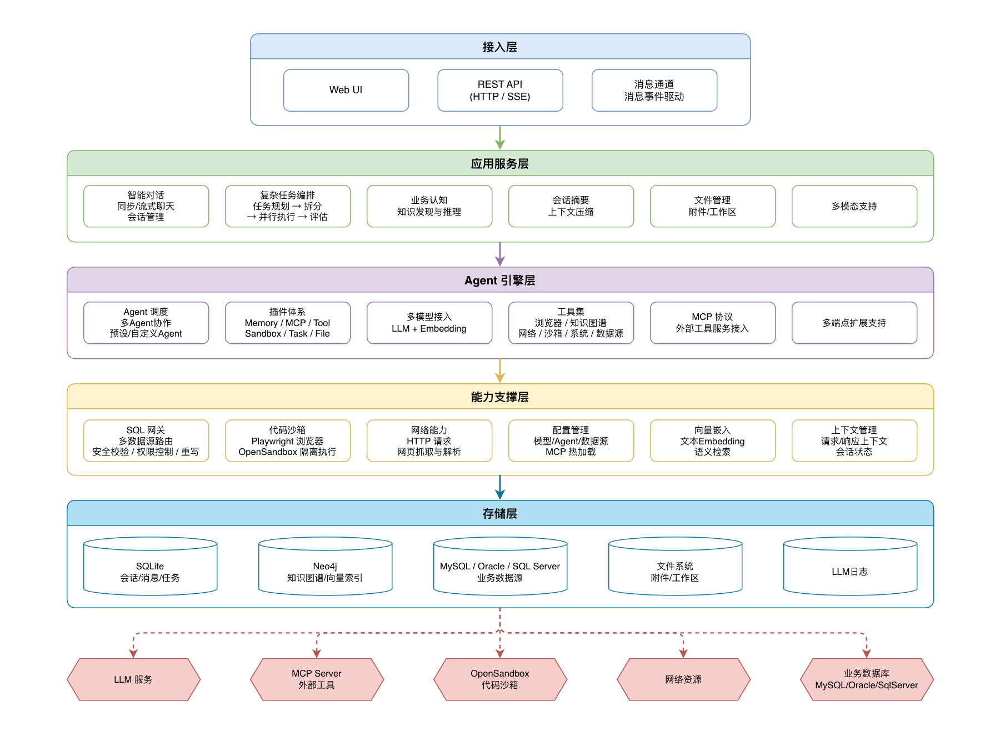

<h1 align="center" style="text-align:center;">

<br />
ActX
</h1>
<p align="center">
	<strong>Java General-Purpose Business Agent Application</strong>
    <br/>
    <strong>Lightweight, Highly Extensible, Non-Invasive</strong>
    <br/>
    <strong>Designed to help any Java enterprise project integrate its own dedicated AI agent</strong>
</p>

<p align="center">
    <a target="_blank" href="LICENSE">
		
	</a>
    <a target="_blank" href="https://www.oracle.com/java/technologies/javase/jdk17-archive-downloads.html">
		
	</a>
    <a target="_blank" href="https://www.oracle.com/java/technologies/javase/jdk21-archive-downloads.html">
		
	</a>
    <a target="_blank" href="https://www.oracle.com/java/technologies/downloads/">
		
	</a>
    <a target="_blank" href='https://github.com/jiang2992/ActX/stargazers'>
		
	</a>
    <a target="_blank" href='https://gitee.com/jiang2992/act-x/stargazers'>
        
	</a>
</p>

##### Language: [中文](README_CN.md) | English
##### Full documentation: [ActX Documentation](https://jiang2992.github.io/ActX/en/info.html)

<hr />

## Introduction

ActX is a **Java general-purpose business agent application** built on Spring Boot + Spring AI.

It adopts the design philosophy of "lightweight, highly extensible, and non-invasive", helping any Java enterprise project quickly integrate its own dedicated AI agent.

Additionally, ActX supports proactive enterprise business cognition — autonomously understanding and accumulating business knowledge through business databases, documents, project materials, and other information, structuring it into a knowledge graph to empower agents with business query capabilities.

**Tech Stack:** Spring Boot 3.2 / Spring AI 1.1 / JDK 17+ / SQLite / Neo4j / OpenSandbox

<hr/>

## Feature Showcase

### Multi-Agent Collaboration

- Behind ActX, multiple agents with different responsibilities work collaboratively.
- Agents support flexible management, following the hierarchy: Scenario -> Agent -> Model.

<p align="center">

</p>

<hr/>

### Business Cognition

- ActX autonomously performs business discovery and builds a business cognition layer.
- Proactively confirms speculation results with users, assisting in the accumulation of business knowledge.

<p align="center">


</p>

<hr/>

### Knowledge Query

- Performs data queries based on the constructed knowledge graph.
- Three-layer statement security detection at the data gateway, with support for tenant control, permission control, and more.

<p align="center">


</p>

<hr/>

### Complex Tasks

- When ActX identifies a task as complex, it delegates it to a dedicated task dispatch agent.
- Tasks are automatically decomposed into multiple subtasks, each handled by a specialized agent.
- Task workflow: Evaluation → Planning → Dispatch → Execution → Review → Summary.

<p align="center">

</p>

<hr/>

## Core Capabilities

| Capability | Description |
|---|---|
| **Multi-Model** | Built on the Spring AI framework, supports all mainstream large language models |
| **Multi-Agent** | Multi-agent collaboration with specialized roles; 9 built-in core agents with custom management support |
| **Progressive Tools** | Tools use two-phase loading; tool packages are loaded on demand during task execution |
| **Conversation Memory** | Context memory based on conversations; automatic summary for long conversations |
| **MCP Management** | Supports multi-mode MCP tool integration; connects to external MCP tool servers |
| **Complex Tasks** | Complete task execution system supporting evaluation, planning, dispatch, execution, review, and summary; different subtasks assigned to the best-matching agent; comprehensive task evaluation, node review, and retry mechanisms |
| **File Management** | Full file operation support for agents with comprehensive file permission control |
| **Sandbox Isolation** | Secure isolated code execution environment based on OpenSandbox; supports quick sandboxes and short-term sandboxes |
| **Business Cognition** | Supports business knowledge accumulation through data sources, business materials, and other information to build knowledge graphs |
| **Knowledge Query** | Data queries based on knowledge graphs with statement security review, permission control, and more |
| **Extension Plugins** | Extends agent capabilities through standardized interfaces; different agents can be configured with different plugins |
| **Message Channel** | Message channel extension support, driven by message events; supports quick integration with Feishu, DingTalk, WeChat, or other enterprise internal systems |


## System Architecture

<p align="center">

Application Architecture Diagram
</p>

## Quick Start

### 1. Prerequisites

- JDK 17+
- Maven 3.6+
- Neo4j (optional, for knowledge graph storage)
- Docker, OpenSandbox (optional, for sandbox code execution)

### 2. Clone the Project

```bash
git clone https://github.com/jiang2992/ActX.git
cd ActX
```

### 3. Configure Models

Edit `config/model.json` and fill in your LLM API Key:

```json
{
  "chatModels": [
    {
      "id": "main-pro",
      "supplierName": "OpenAi",
      "modelName": "gpt-4o",
      "baseUrl": "https://api.openai.com/v1",
      "apiKey": "your-api-key",
      "temperature": 0.5,
      "maxTokens": 1000000,
      "enableThink": true
    }
  ],
  "embeddingModels": [
    {
      "id": "embedding-model",
      "supplierName": "OpenAi",
      "modelName": "text-embedding-3-small",
      "baseUrl": "https://api.openai.com/v1",
      "apiKey": "your-api-key",
      "dimensions": 1536
    }
  ]
}
```

> 1. Currently supports OpenAi, ZhipuAi, and Deepseek. For other model providers, you need to add the corresponding Spring AI implementation and implement the ModelFactory interface.
> 2. If you are using a TokenPlan or similar package, it is recommended to use the OpenAi interface directly.
> 3. It is recommended to keep at least three model configurations: main-pro, main-pro-json, and main-pro-unthink. If that's not possible, you can keep only main-pro (you will need to modify the model references in each agent).
> 4. If you need to use business knowledge cognition, you must configure the embedding-model.

### 4. Configure Data Sources (Optional)

Edit `config/datasource.json` to add enterprise database connections:

```json
{
  "dataSources": {
    "my-db": {
      "type": "mysql",
      "url": "jdbc:mysql://localhost:3306/mydb",
      "username": "root",
      "password": "your-password"
    }
  }
}
```

> If you need to use business knowledge cognition, you must configure data sources.

### 5. Other Dependencies (Optional)
The `env` directory contains configuration files for Neo4j and OpenSandbox.
- neo4j/docker-compose.yml: By default, simply run `docker-compose up -d`.
- opensandbox/sandbox.toml: Make sure OpenSandbox is installed, then modify the `allowed_host_paths` configuration to match the path configured in `application.yml` under `actx.storage.file.dir`, and start it with `opensandbox-server --config ./env/opensandbox/sandbox.toml`.


### 6. Start the Application

```bash
mvn spring-boot:run
```

After startup, visit `http://localhost:8080` to use.

## Documentation

Full documentation: [ActX Documentation](https://jiang2992.github.io/ActX/en/info.html)
> Extensibility is a core advantage of ActX, supporting any feature extension or secondary development.

## Project Structure

```
ActX
├── config/                  # Runtime configuration directory
│   ├── agent/               # Agent definitions (each subdirectory is one Agent)
│   │   ├── chat/            # Default chat Agent
│   │   ├── task_evaluate/   # Task evaluation Agent
│   │   ├── task_planning/   # Task planning Agent
│   │   ├── task_dispatcher/ # Task dispatch Agent
│   │   ├── coding_task/     # Coding task Agent
│   │   ├── general_task/    # General task Agent
│   │   ├── business_discover/ # Business discovery Agent
│   │   └── summary/         # Summary Agent
│   ├── actx.json            # Scenario routing configuration
│   ├── model.json           # Model configuration
│   ├── mcp.json             # MCP tool configuration
│   └── datasource.json      # Data source configuration
├── src/main/java/com/bin/actx/
│   ├── agent/               # Agent core framework
│   ├── channel/             # Message channels
│   ├── config/              # Configuration loading and management
│   ├── controller/          # Web interfaces
│   ├── plugin/              # Plugin system
│   ├── task/                # Task orchestration engine
│   ├── tool/                # Tool packages
│   ├── mcp/                 # MCP client
│   ├── sandbox/             # Sandbox management
│   ├── storage/             # Storage layer (SQLite / Neo4j)
│   ├── file/                # File management
│   ├── embedding/           # Vector embedding
│   └── sql/                 # SQL parsing and execution
├── file/                    # File storage directory
│   ├── attachment/          # Attachment storage
│   └── workspace/           # Workspace (sandbox outputs, etc.)
└── db/                      # SQLite database
```

## Contact

- GitHub: [jiang2992](https://github.com/jiang2992)
- Project: [https://github.com/jiang2992/ActX](https://github.com/jiang2992/ActX)
- QQ: [651520057](tencent://AddContact/?fromId=45&fromSubId=1&subcmd=all&uin=651520057)
- Stars, Forks, Issues, and PRs are welcome!
