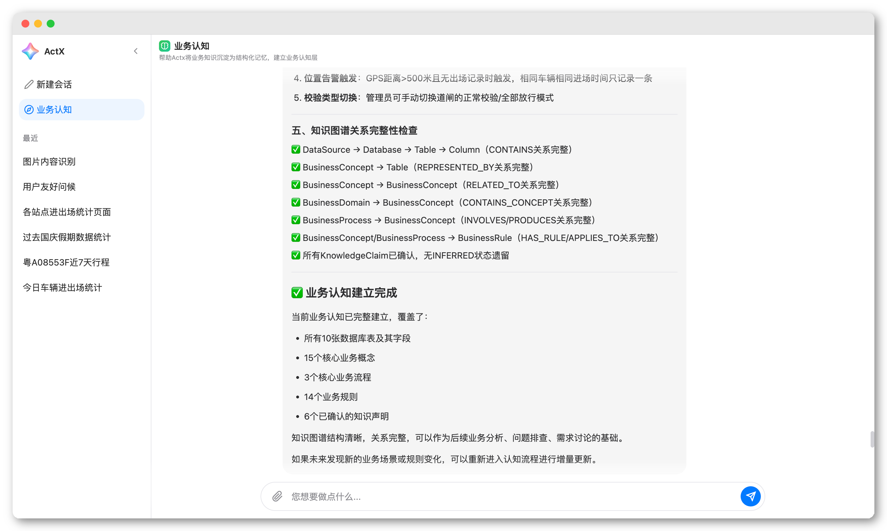
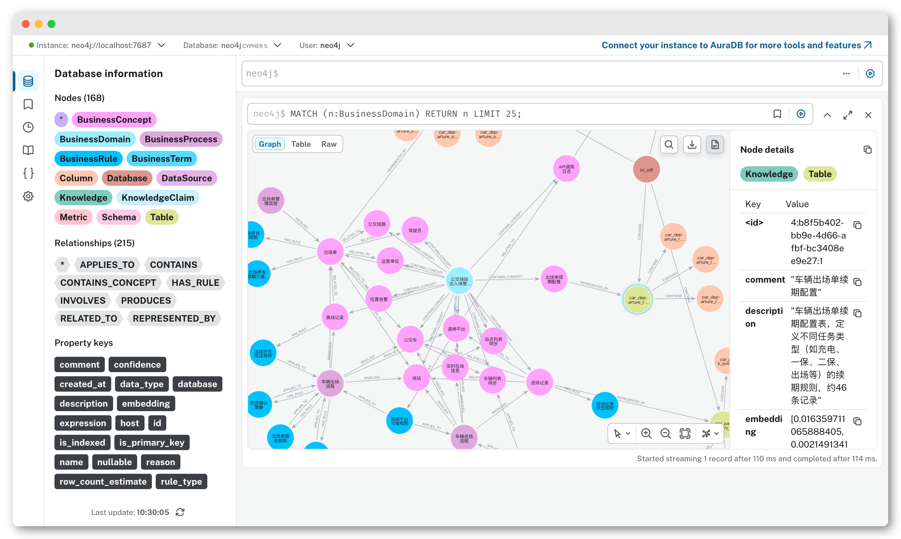

<h1 align="center" style="text-align:center;">

<br />
ActX
</h1>
<p align="center">
	<strong>Java通用业务智能体应用</strong>
    <br/>
    <strong>轻量级、扩展强、无侵入</strong>
    <br/>
    <strong>旨在帮助任何Java企业项目接入专属的Ai智能体</strong>
</p>

<p align="center">
    <a target="_blank" href="LICENSE">
		
	</a>
    <a target="_blank" href="https://www.oracle.com/java/technologies/javase/jdk17-archive-downloads.html">
		
	</a>
    <a target="_blank" href="https://www.oracle.com/java/technologies/javase/jdk21-archive-downloads.html">
		
	</a>
    <a target="_blank" href="https://www.oracle.com/java/technologies/downloads/">
		
	</a>
    <a target="_blank" href='https://github.com/jiang2992/ActX/stargazers'>
		
	</a>
</p>

##### 语言： 中文 | [English](README_EN.md)

<hr />

## 简介

ActX 是一个基于 Spring Boot + Spring AI 构建的 **Java 通用业务智能体应用**。

它以「轻量级、扩展强、无侵入」为设计理念，帮助任何 Java 企业项目快速接入专属的 AI 智能体。

同时，ActX 支持企业业务主动认知，通过业务数据库、业务文档、项目资料等信息来自主理解和沉淀业务知识，结构化为知识图谱，为智能体赋予业务查询能力。

**技术栈：** Spring Boot 3.2 / Spring AI 1.1 / JDK 17+ / SQLite / Neo4j / OpenSandbox

<hr/>

## 功能展示

### 多Agent协作

- ActX 背后是多个不同职责的 Agent 协同工作。
- Agent 支持自由管理，依次是 场景 -> Agent -> 模型。

<p align="center">

</p>

<hr/>

### 业务认知

- ActX 自主进行业务发现，构建业务认知层。
- 主动向用户确认推测结果，协助完成业务知识的沉淀。

<p align="center">


</p>

<hr/>

### 知识查询

- 基于已构建的知识图谱，进行数据查询。
- 数据网关三层语句安全检测，同时支持租户控制、权限控制等。

<p align="center">


</p>

<hr/>

### 复杂任务

- ActX 将任务标识为复杂任务，会交给专门的任务调度 Agent 来处理。
- 任务自动拆分为多个子任务，不同子任务由专门的 Agent 负责。
- 任务流程：评估 → 规划 → 调度 → 执行 → 评审 → 总结。

<p align="center">

</p>

<hr/>

## 核心能力

| 能力           | 说明                                                             |
|--------------|----------------------------------------------------------------|
| **Agent 定义** | 通过 `agent.json` + `prompt.md` 声明式定义 Agent，支持模型、工具、插件的灵活配置      |
| **任务编排**     | 多 Agent 协作的 Task Flow：评估 → 规划 → 调度 → 执行 → 总结，全流程可控             |
| **插件体系**     | 内置 Memory、File、Sandbox、MCP、Summary、Task、Business 等核心插件，支持自定义扩展 |
| **工具包**      | 支持动态工具注册，Agent 可按需调用工具，实现数据库查询、网络请求、代码执行等能力                    |
| **消息通道**     | 提供 Chat / Task / SSE / Direct 等多种消息通道，适配不同交互场景                 |
| **配置热加载**    | 所有配置基于 JSON 文件，修改后自动生效，无需重启服务                                  |
| **多模型管理**    | 支持同时配置多个大模型（Chat + Embedding），Agent 可按需引用不同模型                  |
| **沙箱隔离**     | 基于 OpenSandbox 提供安全隔离的代码执行环境，支持快速沙箱池化                          |
| **知识图谱**     | 集成 Neo4j，支持业务关系的自动发现、存储与检索                                     |

## 快速开始

### 1. 环境要求

- JDK 17+
- Maven 3.6+
- Neo4j（可选，用于知识图谱存储）
- Docker（可选，用于沙箱代码执行）

### 2. 克隆项目

```bash
git clone https://github.com/jiang2992/ActX.git
cd ActX
```

### 3. 配置模型

编辑 `config/model.json`，填入你的大模型 API Key：

```json
{
  "chatModels": [
    {
      "id": "main-pro",
      "supplierName": "OpenAi",
      "modelName": "gpt-4o",
      "baseUrl": "https://api.openai.com/v1",
      "apiKey": "your-api-key",
      "temperature": 0.5,
      "maxTokens": 1000000,
      "enableThink": true
    }
  ],
  "embeddingModels": [
    {
      "id": "embedding-model",
      "supplierName": "OpenAi",
      "modelName": "text-embedding-3-small",
      "baseUrl": "https://api.openai.com/v1",
      "apiKey": "your-api-key",
      "dimensions": 1536
    }
  ]
}
```

> 支持 OpenAI、智谱 AI、DeepSeek 等多种模型供应商，均兼容 OpenAI 协议格式。

### 4. 配置数据源（可选）

编辑 `config/datasource.json`，添加企业数据库连接：

```json
{
  "dataSources": {
    "my-db": {
      "type": "mysql",
      "url": "jdbc:mysql://localhost:3306/mydb",
      "username": "root",
      "password": "your-password"
    }
  }
}
```

### 5. 启动应用

```bash
mvn spring-boot:run
```

启动后访问 `http://localhost:8080` 即可使用。

## 功能扩展

### 自定义 Agent

在 `config/agent/` 目录下新建文件夹，添加 `agent.json` 和 `prompt.md`：

```json
{
  "id": "my-agent",
  "name": "My Custom Agent",
  "description": "自定义 Agent 描述",
  "model": "main-pro",
  "systemPromptFile": "./config/agent/my_agent/prompt.md",
  "privatize": true,
  "toolkits": "*",
  "toolMode": "dynamic",
  "plugins": [
    {
      "class": "com.bin.actx.plugin.core.memory.SessionMemoryPlugin"
    },
    {
      "class": "com.bin.actx.plugin.core.file.FilePlugin"
    }
  ]
}
```

**关键字段说明：**

| 字段                 | 说明                                      |
|--------------------|-----------------------------------------|
| `id`               | Agent 唯一标识                              |
| `model`            | 引用的模型 ID，需在 `model.json` 中预先定义          |
| `systemPromptFile` | 系统提示词文件路径，支持 Markdown 格式                |
| `privatize`        | 是否为私有 Agent（私有 Agent 不会出现在公共 Agent 列表中） |
| `toolkits`         | 可用工具集，`"*"` 表示所有工具，也可指定具体工具名称           |
| `toolMode`         | 工具模式：`dynamic` 动态加载 / `static` 静态全量加载   |
| `plugins`          | 插件列表，按顺序加载执行                            |

### 接入 MCP 工具

编辑 `config/mcp.json`，添加 MCP Server 配置即可为 Agent 扩展外部工具能力：

```json
{
  "mcpServers": {
    "my-mcp-server": {
      "url": "http://localhost:3000/mcp",
      "description": "我的 MCP 工具服务器"
    }
  }
}
```

### 自定义插件

实现 `Plugin` 接口，在 Agent 的 `plugins` 配置中引用即可。插件可拦截 Agent 执行流程、注入上下文信息、扩展工具集。

内置插件一览：

| 插件                    | 说明                      |
|-----------------------|-------------------------|
| `SessionMemoryPlugin` | 会话记忆管理，自动维护多轮对话上下文      |
| `FilePlugin`          | 文件管理，支持文件上传、解析与内容提取     |
| `SandboxPlugin`       | 沙箱代码执行，在安全隔离环境中运行代码     |
| `McpPlugin`           | MCP 工具接入，连接外部 MCP 工具服务器 |
| `SummaryPlugin`       | 对话与任务总结，自动提炼关键信息        |
| `TaskPlugin`          | 任务管理，支持任务的创建、跟踪与协调      |
| `BusinessReferPlugin` | 业务知识引用，自动关联已发现的企业业务关系   |

### 配置场景路由

在 `config/actx.json` 中配置不同场景使用的 Agent：

```json
{
  "scenes": {
    "chat": {
      "agent": "chat-agent"
    },
    "taskEvaluate": {
      "agent": "task-evaluate-agent"
    },
    "taskPlanning": {
      "agent": "task-planning-agent"
    },
    "taskDispatcher": {
      "agent": "task-dispatcher-agent"
    },
    "businessDiscover": {
      "agent": "business-discover-agent"
    }
  }
}
```

## 项目结构

```
ActX
├── config/                  # 运行配置目录
│   ├── agent/               # Agent 定义（每个子目录为一个 Agent）
│   │   ├── chat/            # 默认对话 Agent
│   │   ├── task_evaluate/   # 任务评估 Agent
│   │   ├── task_planning/   # 任务规划 Agent
│   │   ├── task_dispatcher/ # 任务调度 Agent
│   │   ├── coding_task/     # 编码任务 Agent
│   │   ├── general_task/    # 通用任务 Agent
│   │   ├── business_discover/ # 业务发现 Agent
│   │   └── summary/         # 总结 Agent
│   ├── actx.json            # 场景路由配置
│   ├── model.json           # 模型配置
│   ├── mcp.json             # MCP 工具配置
│   └── datasource.json      # 数据源配置
├── src/main/java/com/bin/actx/
│   ├── agent/               # Agent 核心框架
│   ├── channel/             # 消息通道
│   ├── config/              # 配置加载与管理
│   ├── controller/          # Web 接口
│   ├── plugin/              # 插件体系
│   ├── task/                # 任务编排引擎
│   ├── tool/                # 工具包
│   ├── mcp/                 # MCP 客户端
│   ├── sandbox/             # 沙箱管理
│   ├── storage/             # 存储层（SQLite / Neo4j）
│   ├── file/                # 文件管理
│   ├── embedding/           # 向量嵌入
│   └── sql/                 # SQL 解析与执行
├── file/                    # 文件存储目录
│   ├── attachment/          # 附件存储
│   └── workspace/           # 工作空间（沙箱产出物等）
└── db/                      # SQLite 数据库
```

## 联系作者

- GitHub: [jiang2992](https://github.com/jiang2992)
- 项目地址: [https://github.com/jiang2992/ActX](https://github.com/jiang2992/ActX)
- 联系QQ：[651520057](tencent://AddContact/?fromId=45&fromSubId=1&subcmd=all&uin=651520057)
- 欢迎 Star、Fork、提交 Issue 和 PR！