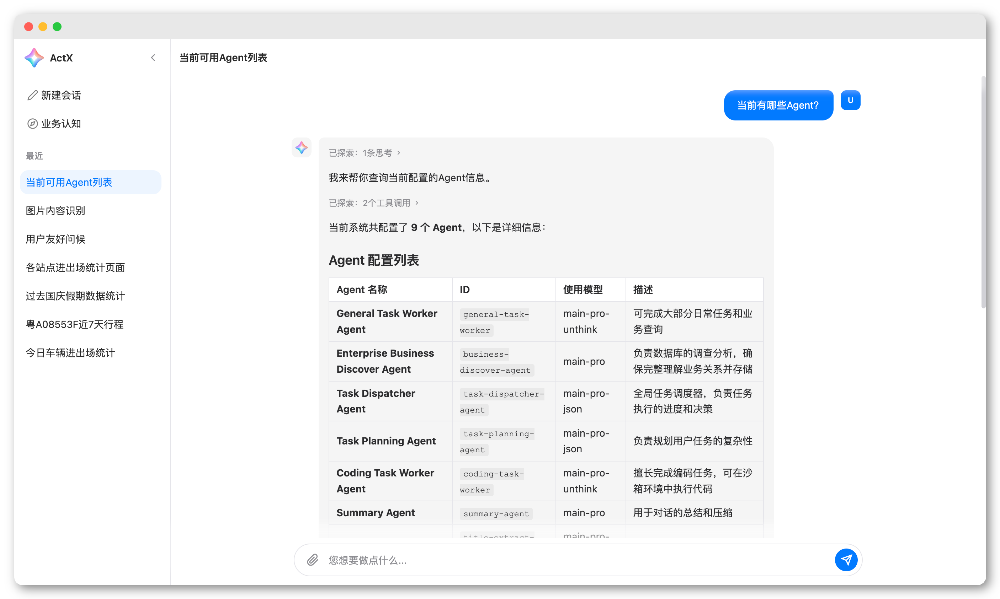
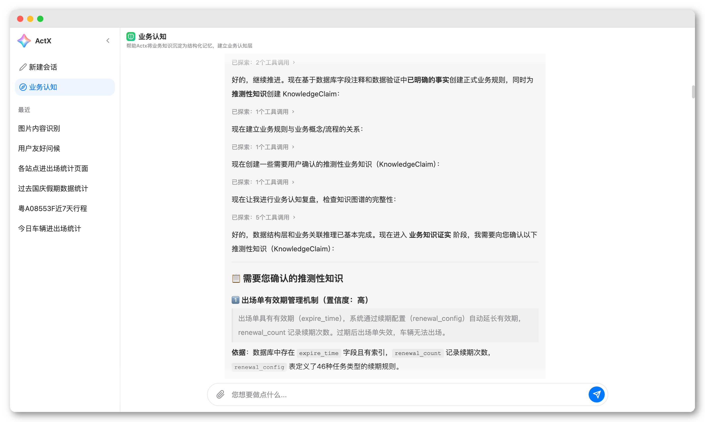
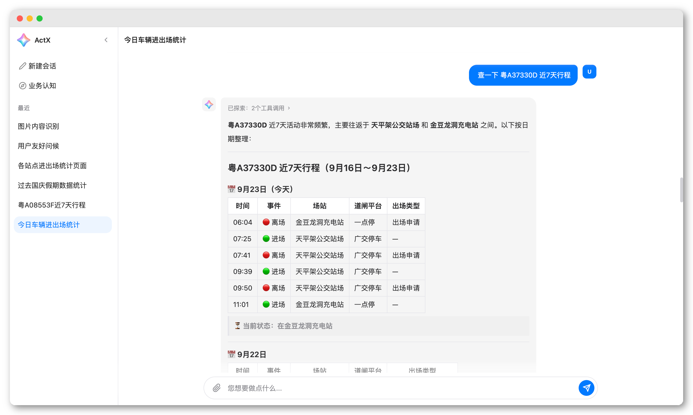
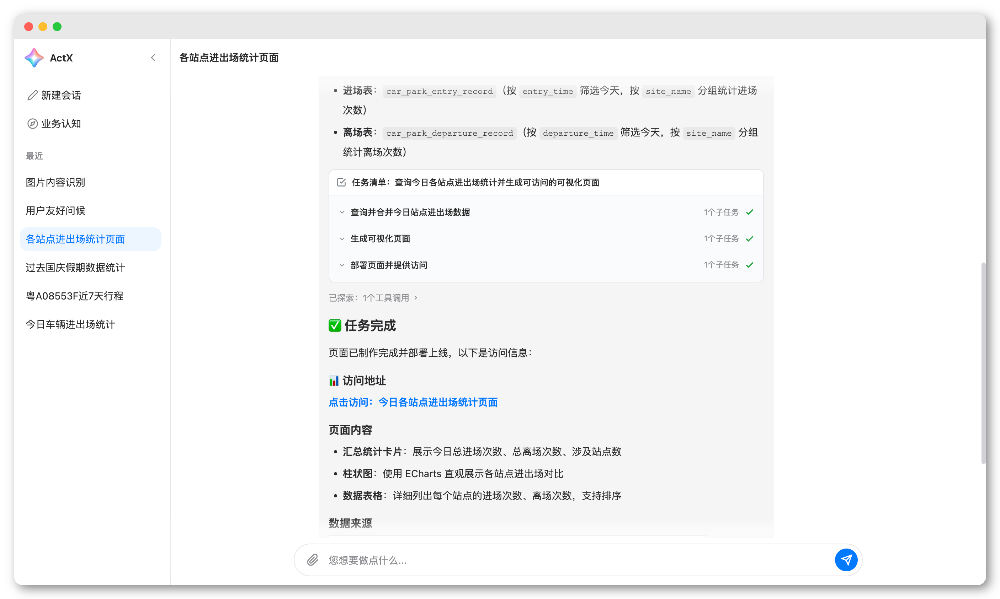

<h1 align="center" style="text-align:center;">

<br />
ActX
</h1>
<p align="center">
	<strong>Java通用业务智能体应用</strong>
    <br/>
    <strong>轻量级、扩展强、无侵入</strong>
    <br/>
    <strong>旨在帮助任何Java企业项目接入专属的Ai智能体</strong>
</p>

<p align="center">
    <a target="_blank" href="LICENSE">
		
	</a>
    <a target="_blank" href="https://www.oracle.com/java/technologies/javase/jdk17-archive-downloads.html">
		
	</a>
    <a target="_blank" href="https://www.oracle.com/java/technologies/javase/jdk21-archive-downloads.html">
		
	</a>
    <a target="_blank" href="https://www.oracle.com/java/technologies/downloads/">
		
	</a>
    <a target="_blank" href='https://github.com/jiang2992/ActX/stargazers'>
		
	</a>
</p>

##### 语言： 中文 | [English](README.md)

<hr />

## 简介

ActX 是一个基于 Spring Boot + Spring AI 构建的 **Java 通用业务智能体应用**。

它以「轻量级、扩展强、无侵入」为设计理念，帮助任何 Java 企业项目快速接入专属的 AI 智能体。

同时，ActX 支持企业业务主动认知，通过业务数据库、业务文档、项目资料等信息来自主理解和沉淀业务知识，结构化为知识图谱，为智能体赋予业务查询能力。

**技术栈：** Spring Boot 3.2 / Spring AI 1.1 / JDK 17+ / SQLite / Neo4j / OpenSandbox

<hr/>

## 功能展示

### 多Agent协作

- ActX 背后是多个不同职责的 Agent 协同工作。
- Agent 支持自由管理，依次是 场景 -> Agent -> 模型。

<p align="center">

</p>

<hr/>

### 业务认知

- ActX 自主进行业务发现，构建业务认知层。
- 主动向用户确认推测结果，协助完成业务知识的沉淀。

<p align="center">


</p>

<hr/>

### 知识查询

- 基于已构建的知识图谱，进行数据查询。
- 数据网关三层语句安全检测，同时支持租户控制、权限控制等。

<p align="center">


</p>

<hr/>

### 复杂任务

- ActX 将任务标识为复杂任务，会交给专门的任务调度 Agent 来处理。
- 任务自动拆分为多个子任务，不同子任务由专门的 Agent 负责。
- 任务流程：评估 → 规划 → 调度 → 执行 → 评审 → 总结。

<p align="center">

</p>

<hr/>

## 核心能力

| 能力         | 说明                                                                   |
|------------|----------------------------------------------------------------------|
| **多模型**    | 基于 SpringAi 框架，支持市面上所有主流的大模型                                         |
| **多Agent** | 多Agent协作，各司其职，内置9个核心Agent，支持自定义管理                                    |
| **渐进式工具**  | 工具采用二阶段加载，任务过程按需加载工具包                                                |
| **会话记忆**   | 基于会话的上下文记忆，长会话自动总结摘要                                                 |
| **MCP管理**  | 支持多模式MCP工具接入，连接外部 MCP 工具服务器                                          |
| **复杂任务**   | 完整的任务执行体系，支持任务评估、规划、调度、执行、评审、总结，不同的子任务由最匹配的Agent负责，完善的任务评估、节点评审、重试机制 |
| **文件管理**   | 为Agent提供完整的文件操作支持，完善的文件权限控制                                          |
| **沙箱隔离**   | 基于 OpenSandbox 提供安全隔离的代码执行环境，支持快速沙箱和短期沙箱                             |
| **业务认知**   | 支持通过数据源、业务资料等信息进行业务知识沉淀，构建知识图谱                                       |
| **知识查询**   | 基于知识图谱进行数据查询，支持语句的安全审查、权限控制等                                         |
| **扩展插件**   | 通过统一标准接口实现智能体的能力扩展，不同Agent可以配置不同的插件                                  |
| **消息通道**   | 消息通道扩展支持，由消息事件驱动，支持快速整合飞书、钉钉、微信或其他企业内部系统                             |

## 系统架构
> 待补充~

## 快速开始

### 1. 环境要求

- JDK 17+
- Maven 3.6+
- Neo4j（可选，用于知识图谱存储）
- Docker、OpenSandbox（可选，用于沙箱代码执行）

### 2. 克隆项目

```bash
git clone https://github.com/jiang2992/ActX.git
cd ActX
```

### 3. 配置模型

编辑 `config/model.json`，填入你的大模型 API Key：

```json
{
  "chatModels": [
    {
      "id": "main-pro",
      "supplierName": "OpenAi",
      "modelName": "gpt-4o",
      "baseUrl": "https://api.openai.com/v1",
      "apiKey": "your-api-key",
      "temperature": 0.5,
      "maxTokens": 1000000,
      "enableThink": true
    }
  ],
  "embeddingModels": [
    {
      "id": "embedding-model",
      "supplierName": "OpenAi",
      "modelName": "text-embedding-3-small",
      "baseUrl": "https://api.openai.com/v1",
      "apiKey": "your-api-key",
      "dimensions": 1536
    }
  ]
}
```

> 1. 目前支持 OpenAi、ZhipuAi、Deepseek，如需其他模型供应商，需添加SpringAi对应实现，然后实现ModelFactory接口。
> 2. 如果使用的是 TokenPlan 之类的套餐，建议直接使用 OpenAi 接口即可。
> 3. 建议至少保留 main-pro、main-pro-json、main-pro-unthink 三种模型配置，如果实在没有，可以只保留 main-pro（需要修改各个Agent的模型引用）。
> 4. 如果需要使用业务知识认知，必须配置 embedding-model。

### 4. 配置数据源（可选）

编辑 `config/datasource.json`，添加企业数据库连接：

```json
{
  "dataSources": {
    "my-db": {
      "type": "mysql",
      "url": "jdbc:mysql://localhost:3306/mydb",
      "username": "root",
      "password": "your-password"
    }
  }
}
```

> 如果需要使用业务知识认知，必须配置数据源。

### 5. 其他依赖（可选）
在 `env` 目录下包含了 Neo4j 和 OpenSandbox 相关的配置文件。 
- neo4j/docker-compose.yml: 默认情况下，直接 `docker-compose up -d` 即可。
- opensandbox/sandbox.toml: 确保已经安装了 OpenSandbox 的情况下，修改 `allowed_host_paths` 配置，确保与 `application.yml` 中 `actx.storage.file.dir` 配置的路径一致，然后通过 `opensandbox-server --config ./env/opensandbox/sandbox.toml` 启动。


### 6. 启动应用

```bash
mvn spring-boot:run
```

启动后访问 `http://localhost:8080` 即可使用。

## 开发文档

扩展能力是 ActX 的一大核心优势，支持任何功能扩展或二次开发。
<br/>
完整开发文档：[ActX 开发文档](https://jiang2992.github.io/ActX/)

## 项目结构

```
ActX
├── config/                  # 运行配置目录
│   ├── agent/               # Agent 定义（每个子目录为一个 Agent）
│   │   ├── chat/            # 默认对话 Agent
│   │   ├── task_evaluate/   # 任务评估 Agent
│   │   ├── task_planning/   # 任务规划 Agent
│   │   ├── task_dispatcher/ # 任务调度 Agent
│   │   ├── coding_task/     # 编码任务 Agent
│   │   ├── general_task/    # 通用任务 Agent
│   │   ├── business_discover/ # 业务发现 Agent
│   │   └── summary/         # 总结 Agent
│   ├── actx.json            # 场景路由配置
│   ├── model.json           # 模型配置
│   ├── mcp.json             # MCP 工具配置
│   └── datasource.json      # 数据源配置
├── src/main/java/com/bin/actx/
│   ├── agent/               # Agent 核心框架
│   ├── channel/             # 消息通道
│   ├── config/              # 配置加载与管理
│   ├── controller/          # Web 接口
│   ├── plugin/              # 插件体系
│   ├── task/                # 任务编排引擎
│   ├── tool/                # 工具包
│   ├── mcp/                 # MCP 客户端
│   ├── sandbox/             # 沙箱管理
│   ├── storage/             # 存储层（SQLite / Neo4j）
│   ├── file/                # 文件管理
│   ├── embedding/           # 向量嵌入
│   └── sql/                 # SQL 解析与执行
├── file/                    # 文件存储目录
│   ├── attachment/          # 附件存储
│   └── workspace/           # 工作空间（沙箱产出物等）
└── db/                      # SQLite 数据库
```

## 联系作者

- GitHub: [jiang2992](https://github.com/jiang2992)
- 项目地址: [https://github.com/jiang2992/ActX](https://github.com/jiang2992/ActX)
- 联系QQ：[651520057](tencent://AddContact/?fromId=45&fromSubId=1&subcmd=all&uin=651520057)
- 欢迎 Star、Fork、提交 Issue 和 PR！